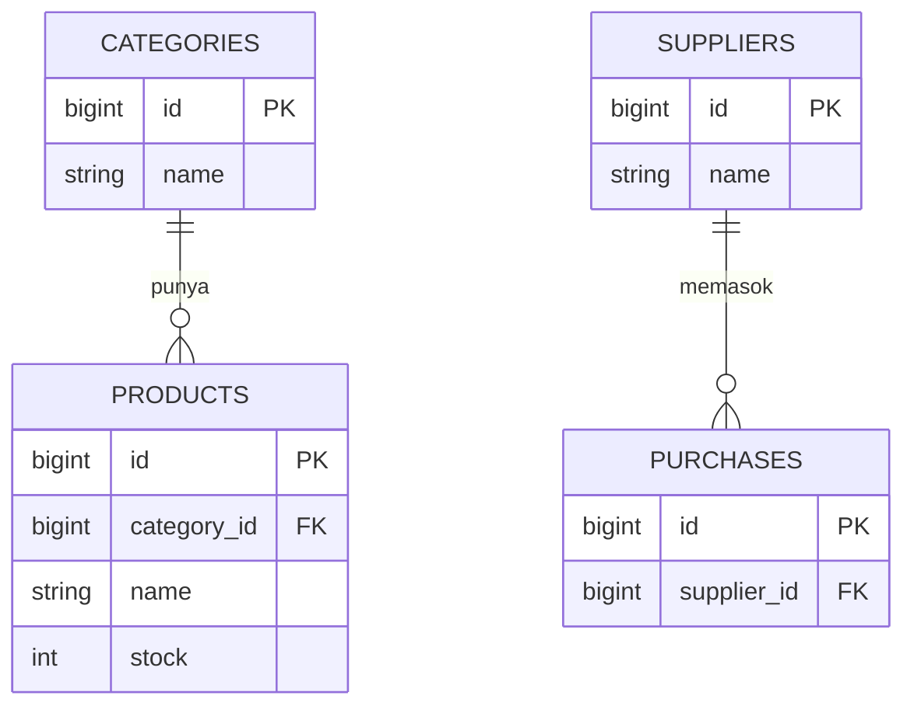

# toko-online Toko Online — Toko Nisya

Aplikasi web berbasis Laravel untuk membantu Toko Nisya mengelola stok barang, data pemasok, pembelian, dan penjualan dalam satu tempat.

Dibuat sebagai tugas Ujian Tengah Semester (UTS) mata kuliah Pemrograman Web.

---

## Daftar Isi

1. [Tentang Proyek](#1-tentang-proyek)
2. [Kebutuhan Sistem](#2-kebutuhan-sistem)
3. [Cara Instalasi](#3-cara-instalasi)
4. [Pengaturan Environment](#4-pengaturan-environment)
5. [Migrasi dan Seeder](#5-migrasi-dan-seeder)
6. [Akun Demo](#6-akun-demo)
7. [Fitur](#7-fitur)
8. [Batasan Sistem](#8-batasan-sistem)
9. [Pengujian](#9-pengujian)
10. [Tampilan Aplikasi](#10-tampilan-aplikasi)
11. [Struktur Folder](#11-struktur-folder)
12. [Pembuat](#12-pembuat)

---

## 1. Tentang Proyek

Toko Nisya membutuhkan cara yang lebih rapi untuk mencatat barang masuk dan barang keluar. Aplikasi ini dibuat agar pemilik toko bisa:

- melihat daftar produk beserta kategori dan stoknya,
- menyimpan data supplier tempat barang dibeli,
- mencatat pembelian barang dari supplier,
- mencatat penjualan kepada pelanggan,
- melihat rekap pembelian dan penjualan dalam bentuk laporan.

**Teknologi:** PHP, Laravel, Blade Template, MySQL, JavaScript.

---

## 2. Kebutuhan Sistem

- PHP (lihat versi minimal di `composer.json`)
- Composer
- MySQL
- Node.js dan NPM (jika aset frontend perlu dikompilasi)

---

## 3. Cara Instalasi

```bash
# 1. Salin repositori ke komputer
git clone https://github.com/nisyatulf-cmd/-toko-online.git
cd -toko-online

# 2. Pasang dependency PHP
composer install

# 3. (Opsional) Pasang dependency frontend
npm install
npm run build
```

---

## 4. Pengaturan Environment

```bash
# Salin file contoh environment
copy .env.example .env

# Buat application key
php artisan key:generate
```

Buka file `.env`, lalu isi pengaturan database sesuai komputermu:

```env
DB_CONNECTION=mysql
DB_HOST=127.0.0.1
DB_PORT=3306
DB_DATABASE=nama_database
DB_USERNAME=root
DB_PASSWORD=
```

Buat dulu database kosong dengan nama yang sama di MySQL (misalnya lewat phpMyAdmin).

---

## 5. Migrasi dan Seeder

```bash
php artisan migrate --seed
```

Perintah ini membuat semua tabel dan mengisi data awal. Setelah selesai, jalankan aplikasi:

```bash
php artisan serve
```

Lalu buka `http://127.0.0.1:8000` di browser.

### Diagram Relasi Tabel



---

## 6. Akun Demo

Setelah menjalankan seeder, kamu bisa masuk dengan akun berikut:

| Peran | Email | Password |
|-------|-------|----------|
| Admin | admin@toko-online.com | admin12345 |
| Staff | staff@toko-online.com | staff12345 |

---

## 7. Fitur

- **Dashboard:** ringkasan data toko dalam satu halaman.
- **Produk:** tambah, ubah, hapus, dan lihat daftar produk.
- **Kategori:** mengelompokkan produk berdasarkan jenisnya.
- **Supplier:** menyimpan data pemasok barang.
- **Pembelian:** mencatat barang yang dibeli dari supplier.
- **Penjualan:** mencatat barang yang terjual kepada pelanggan.
- **Laporan:** rekap data pembelian dan penjualan.
- **Logout:** keluar dari akun dengan aman.

---

## 8. Batasan Sistem

- Aplikasi dibuat untuk satu toko saja.
- Pembayaran hanya dicatat di sistem, belum terhubung ke layanan pembayaran online.
- Laporan hanya ditampilkan di layar, belum bisa diekspor ke PDF atau Excel.
- Aplikasi berjalan di browser, belum ada versi aplikasi Android atau iOS.
- Belum ada fitur prediksi kebutuhan stok otomatis.

---

## 9. Pengujian

Pengujian dilakukan secara manual dengan menjalankan aplikasi lewat `php artisan serve`.

| No | Skenario | Langkah singkat | Hasil yang diharapkan |
|----|----------|-----------------|-----------------------|
| 1 | Login | Masuk dengan akun demo | Berhasil masuk ke dashboard |
| 2 | Tambah kategori | Isi nama kategori lalu simpan | Kategori muncul di daftar |
| 3 | Tambah produk | Isi data produk dan pilih kategori | Produk muncul di daftar produk |
| 4 | Tambah supplier | Isi data supplier lalu simpan | Supplier muncul di daftar |
| 5 | Catat pembelian | Pilih supplier dan produk, isi jumlah | Stok produk bertambah |
| 6 | Catat penjualan | Pilih produk dan isi jumlah | Stok produk berkurang |
| 7 | Lihat laporan | Buka menu laporan | Data pembelian dan penjualan tampil |
| 8 | Logout | Klik logout | Kembali ke halaman login |

---

## 10. Tampilan Aplikasi

> Gambar disimpan di folder `docs/screenshot`.

**Halaman Login**


**Dashboard**


**Data Produk**


**Pembelian**


**Penjualan**

Screenshot aplikasi akan ditambahkan di folder `docs/screenshot`.
---

## 11. Struktur Folder

| Folder | Fungsi |
|--------|--------|
| `app/` | Logika aplikasi (model dan controller) |
| `database/` | Migrasi dan seeder |
| `resources/` | Tampilan (Blade) |
| `routes/` | Daftar route aplikasi |
| `public/` | File publik (gambar, CSS, JS) |
| `tests/` | Pengujian |
| `docs/screenshot/` | Tangkapan layar untuk dokumentasi |

---

## 12. Pembuatan

Dibuat oleh Nisya ([@nisyatulf-cmd](https://github.com/nisyatulf-cmd)).